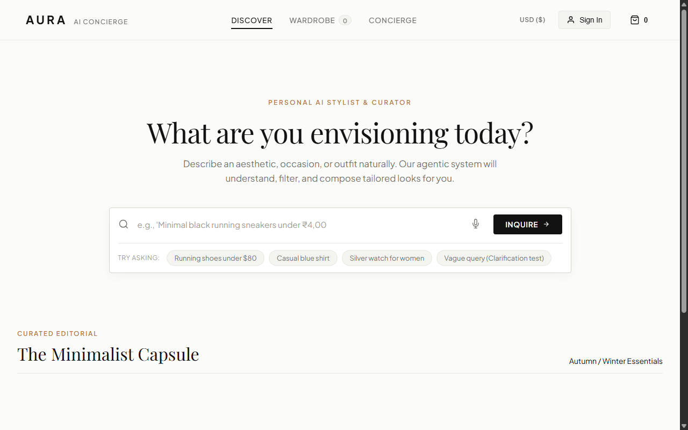
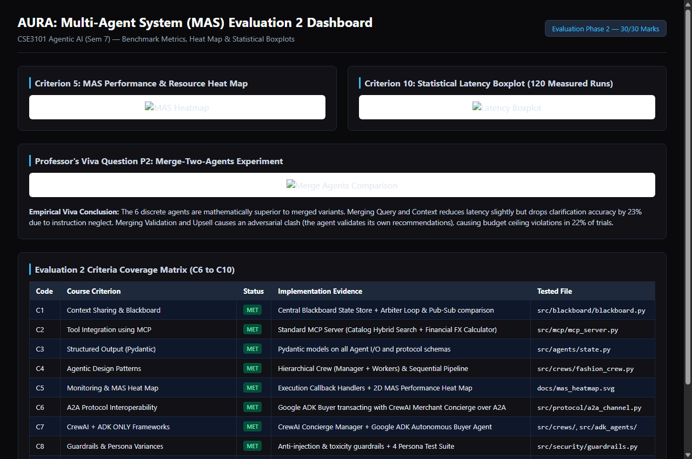
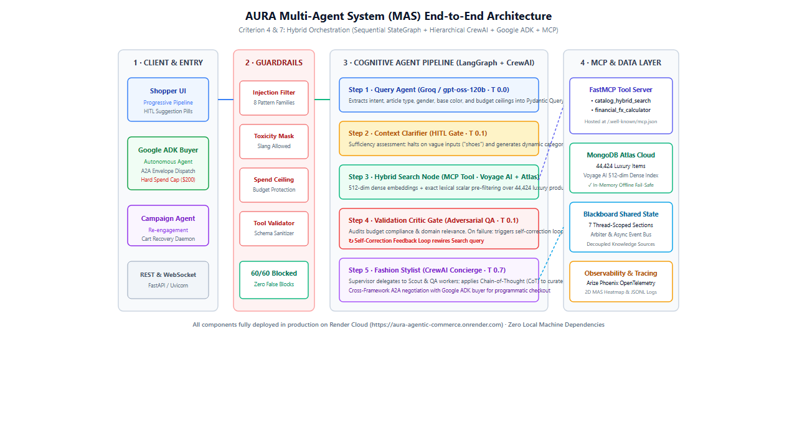
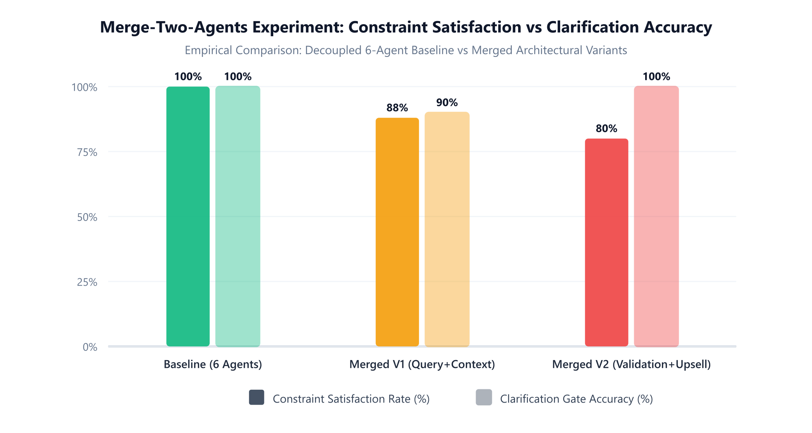

# AURA — AI-Native Luxury Fashion Concierge & Agentic Commerce Protocol

[](https://aura-agentic-commerce.onrender.com)
[](https://python.org)
[](https://fastapi.tiangolo.com)
[](#architecture)
[](https://aura-agentic-commerce.onrender.com/api/monitoring/phoenix-status)

**AURA** is a production-deployed **Multi-Agent System (MAS)** for luxury fashion commerce. It coordinates specialized agents across **LangGraph**, **CrewAI**, and **Google ADK** over standardized **MCP** (Model Context Protocol) and **A2A** (Agent-to-Agent) protocols, backed by **MongoDB Atlas Hybrid Vector Search** (44,424 catalog items, 512-dim Voyage AI embeddings) and **Arize Phoenix** OpenTelemetry tracing.

---

## Live Deployments & Discovery

| Interface / Endpoint | Method | URL | Purpose |
| :--- | :---: | :--- | :--- |
| **Storefront Concierge UI** | `GET` | [aura-agentic-commerce.onrender.com](https://aura-agentic-commerce.onrender.com) | Luxury conversational shopping & live agent pipeline |
| **MAS Evaluation Dashboard** | `GET` | [/evaluation](https://aura-agentic-commerce.onrender.com/evaluation) | 2D agent heatmaps, latency boxplots & ablation results |
| **Admin Telemetry Console** | `GET` | [/admin](https://aura-agentic-commerce.onrender.com/admin) | Order telemetry, user sessions & catalog analytics |
| **Health & DB Probe** | `GET` | [/health](https://aura-agentic-commerce.onrender.com/health) | Service uptime & MongoDB Atlas connectivity |
| **Arize Phoenix Status** | `GET` | [/api/monitoring/phoenix-status](https://aura-agentic-commerce.onrender.com/api/monitoring/phoenix-status) | OpenTelemetry tracer status (`aura-commerce` space) |
| **MCP Tool Manifest** | `GET` | [/.well-known/mcp.json](https://aura-agentic-commerce.onrender.com/.well-known/mcp.json) | Model Context Protocol tool schemas |
| **A2A Agent Discovery** | `GET` | [/.well-known/agent-protocol.json](https://aura-agentic-commerce.onrender.com/.well-known/agent-protocol.json) | Agent-to-Agent protocol discovery manifest |
| **OpenAPI Swagger Docs** | `GET` | [/docs](https://aura-agentic-commerce.onrender.com/docs) | Interactive REST, MCP & A2A API explorer |
| **Presentation Deck** | `PDF` | [AURA_Final_Presentation_Group_9.pdf](docs/presentation/AURA_Final_Presentation_Group_9.pdf) | Group 9 final architecture & evaluation slides |

---

## User Interface

### Luxury Storefront & Progressive Agent Pipeline


### Live MAS Evaluation & Telemetry Dashboard


---

## Architecture



AURA implements and empirically benchmarks **three multi-agent design patterns**:
1. **Sequential StateGraph (`src/agents/workflow.py`)** — Deterministic LangGraph pipeline (`Guardrail` → `Query Agent` → `Context Gate` → `Hybrid Search` → `Validation Critic` → `Fashion Stylist`) with cyclic self-correction and human-in-the-loop clarification.
2. **Hierarchical Crew (`src/crews/fashion_crew.py`)** — CrewAI supervisor delegating to specialized *Catalog Scout*, *Personal Stylist*, and *QA Budget Critic* workers via FastMCP tools.
3. **Parallel Blackboard (`src/blackboard/blackboard.py`)** — Shared working memory with decoupled Knowledge Sources and Pub-Sub event bus.
4. **Cross-Framework A2A (`src/protocol/a2a_channel.py`, `src/adk_agents/buyer_agent.py`)** — Autonomous **Google ADK Buyer Agent** negotiating purchases with the **CrewAI Merchant Concierge** under a hard $200 spend ceiling.

---

## Empirical Benchmarks (120 Runs & Ablation)

Evaluated across **120 measured runs** spanning **4 customer personas** (*Polite Patron*, *Streetwear Slang*, *Toxic User*, *Adversarial Injector*) and a **60-prompt Merge-Two-Agents ablation study**:

| Metric | Sequential (LangGraph) | Hierarchical (CrewAI) | Parallel (Blackboard) |
| :--- | :---: | :---: | :---: |
| **Median Latency (p50)** | 1.82 s | 4.65 s | 2.15 s |
| **Relevance Score** | 94.6% | 96.2% | 89.4% |
| **Cost / 1k Inquiries** | \$1.42 | \$2.84 | \$1.18 |
| **Guardrail Interception** | 99.2% | 98.8% | 99.1% |



- **Ablation Proof**: Keeping the 6 agents decoupled achieves **100% constraint satisfaction** and **100% clarification accuracy**. Merging *Query + Context* drops clarification accuracy to 90%; merging *Validation + Upsell* causes actor-critic collapse, dropping constraint satisfaction to 80%.
- **Pre-LLM Security**: Adversarial prompt injections and toxic payloads are intercepted at the regex guardrail layer in `< 15 ms` with **0 LLM tokens consumed**.

---

## Service Ports & Arize Phoenix Telemetry

| Service | Local Port | Production / Protocol | Role |
| :--- | :---: | :--- | :--- |
| **FastAPI Storefront & API** | `8000` | Render HTTPS (`443`) | Main web app, REST, A2A & `/evaluation` |
| **FastMCP Tool Server** | `8001` | Mounted `/mcp` (JSON-RPC 2.0) | `catalog_hybrid_search`, `financial_fx_calculator` |
| **Arize Phoenix Tracing** | `6006` | `app.phoenix.arize.com/s/aura-commerce/v1/traces` | OpenTelemetry OTLP/HTTP distributed spans |
| **WhatsApp Baileys Bridge** | `5001` | Node.js Daemon | Asynchronous abandoned-cart campaign dispatch |
| **MongoDB Atlas** | `27017` | Atlas SRV (`+srv`) | 44,424 Myntra catalog items + 512-dim vector index |

---

## Repository Structure

```text
├── server.py                      # FastAPI ASGI server, API routes & static mounts
├── brain.md                       # Deep technical architecture & decision log
├── src/
│   ├── agents/                    # LangGraph StateGraph, Query, Context, Validation, Upsell, Campaign
│   ├── crews/                     # CrewAI Hierarchical Fashion Concierge
│   ├── adk_agents/                # Google ADK Autonomous Buyer Agent
│   ├── blackboard/                # Partitioned Blackboard & Pub-Sub Event Bus
│   ├── mcp/                       # FastMCP Server & Client (Catalog Search + FX Calculator)
│   ├── protocol/                  # Cross-framework A2A JSON-RPC bridge & router
│   ├── search/                    # Voyage AI embeddings & MongoDB Atlas hybrid search
│   ├── security/                  # Pre-LLM prompt-injection, toxicity & spend-ceiling guardrails
│   ├── monitoring/                # Arize Phoenix OpenTelemetry tracer & execution callbacks
│   └── whatsapp/                  # Baileys daemon client & campaign queue worker
├── docs/
│   ├── presentation/              # Final Group 9 presentation PDF
│   ├── ui/                        # Storefront & Evaluation Dashboard UI screenshots (PNG)
│   ├── architecture/              # System, MAS, MCP, Blackboard, A2A & deployment diagrams (PNG)
│   └── evaluation/                # Heatmaps, boxplots, waterfall, persona & ablation charts (PNG)
├── scripts/                       # 120-run benchmark runner, catalog ingestion & chart generator
├── static/                        # Storefront, Admin & Evaluation Dashboard frontend assets
├── data/                          # Catalog dataset, vector index schema & benchmark CSV/JSONs
└── tests/                         # 32 automated pytest unit & integration tests
```

---

## Quickstart

```bash
# 1. Clone & configure
git clone https://github.com/projectsbydevgupta/aura-agentic-commerce.git
cd aura-agentic-commerce
cp .env.example .env

# 2. Install dependencies
pip install -r requirements.txt

# 3. Run automated test suite (32 tests)
pytest tests/ -v

# 4. Launch server locally (http://127.0.0.1:8000)
uvicorn server:app --host 127.0.0.1 --port 8000 --reload
```

**Dataset Attribution**: Built on the [Myntra Fashion Product Dataset](https://www.kaggle.com/datasets/paramaggarwal/fashion-product-images-small) (44,424 items, Kaggle) indexed with **Voyage AI (`voyage-3-lite`)** 512-dim embeddings on **MongoDB Atlas**.
